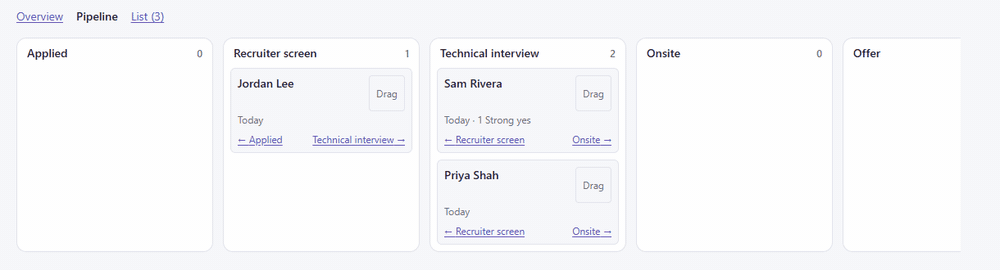
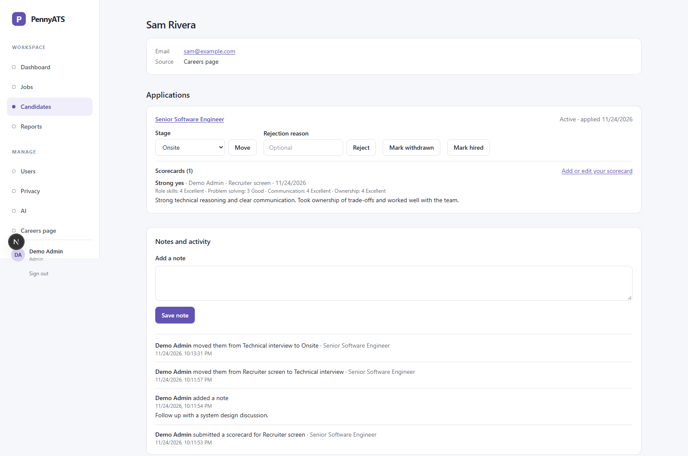
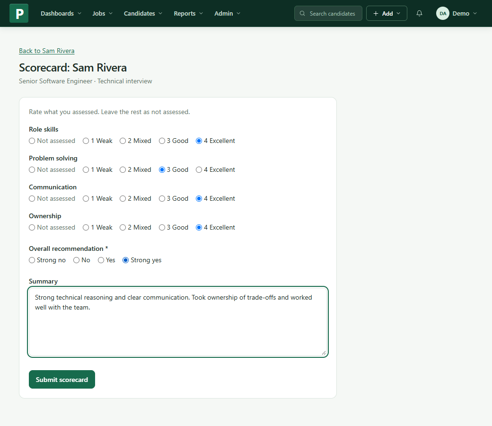

# PennyATS

[](https://github.com/PennyATS/PennyATS/actions/workflows/ci.yml)

**Run your hiring pipeline on your own infrastructure.**

Post jobs, review applicants, and collect interview feedback in one place.
Self-host PennyATS with your own Postgres database. AI features are optional
and off by default.

**Status: Early preview**

[Quick start](#quick-start) · [Roadmap](#roadmap) · [Contributing](CONTRIBUTING.md)

## Preview

These images use fictional candidates from the demo seed.



| Pipeline board | Candidate profile |
| --- | --- |
| [](docs/media/pipeline-board.png) | [](docs/media/candidate-profile.png) |
| **Scorecard** | **Reports** |
| [](docs/media/scorecard.png) | [](docs/media/reports.png) |

## What works today

- **Sign in and roles.** First-run setup creates the admin. Admins invite teammates, change roles, deactivate accounts, and issue one-time password reset links to copy and send. Interviewers only see jobs they're on the hiring team for.
- **Jobs.** Create and edit jobs as draft, open, or closed. Each job has its own pipeline stages (rename, reorder, add, remove) and hiring team.
- **Careers page.** Open jobs are listed at `/careers` with an apply form and resume upload. Includes basic spam protection.
- **Applications.** Candidates are matched by email, so someone applying to a second role keeps one profile. Recruiters can add candidates by hand, move them between stages, reject with a reason, or mark them withdrawn.
- **Pipeline board.** A kanban view per job. Drag candidates between stages, or use the arrow buttons from the keyboard. Cards show days in stage and scorecard results.
- **Interview loop.** Plan the interviews for each stage of a job (who runs them, what they cover, and instructions). Candidates get those interviews automatically when they enter the stage, with a status from "to schedule" to "complete", and the job overview flags interviewers whose feedback is overdue.
- **Scorecards.** Each job has its own list of attributes, rated 1 to 4, plus an overall recommendation from Strong no to Strong yes. Interviewers can't see anyone else's scorecard until they've submitted their own, so earlier feedback doesn't sway them.
- **Candidate profiles.** Contact details, resume download, every application, scorecards, notes, and an activity timeline. Mark candidates hired, rejected, or withdrawn.
- **Reports.** Filter by job and period to see the hiring funnel, time in each stage, time to hire, which sources produce hires, rejection reasons, and how many scorecards each interviewer has submitted.
- **Optional AI.** Bring your own Anthropic or OpenAI key (or a local model through an OpenAI-compatible server like Ollama) to draft job descriptions and summarize interview feedback. Off unless you add a key, and each feature can be switched off.
- **Privacy tools.** A privacy notice and optional consent checkbox on the apply form, one-click export of everything stored about a candidate, permanent deletion, automatic deletion of rejected candidates after a retention period you choose, and an audit log that records each of these without keeping the deleted person's details.

## Quick start

### Docker Compose

Docker Compose runs Postgres, applies migrations, and starts the production app:

```bash
cp .env.example .env
docker compose -f docker/docker-compose.yml up --build -d
```

Open http://localhost:3000 to create the first admin account. The database and uploaded resumes use persistent Docker volumes. See the [deployment guide](docs/deploy.md) before exposing the app to the internet.

### Local development

Requires Node 22+ and pnpm (`corepack enable` gives you the right version).

```bash
pnpm install
cp .env.example .env
```

Point `DATABASE_URL` in `.env` at any Postgres: a free [Neon](https://neon.tech) or Supabase database, RDS, or local Docker. PennyATS is developed and tested on Postgres 18; versions 14 and newer should work but aren't tested.

If you use the local Docker database, start only that service. Then create the tables and start the app:

```bash
docker compose -f docker/docker-compose.yml up -d db
pnpm db:migrate
pnpm dev
```

Open http://localhost:3000 and you'll be asked to create the first admin account.

### Demo data

To try it with sample data instead, run `pnpm db:seed` after migrating. It adds one job, three made-up candidates, and a demo login: `admin@example.com` / `pennyats-demo`. Only use the seed on a throwaway database.

## Privacy

Admins set this up under **Admin → Privacy** in the top navigation:

- **Notice and consent.** Text and a policy link shown on every apply form, with an optional required checkbox. The time of consent is saved on the candidate.
- **Access and deletion requests.** Each candidate profile has *Export all their data* (JSON) and *Delete permanently*, which removes them from every job along with their resume, scorecards, notes, and history.
- **Retention.** Pick a number of months, and rejected or withdrawn candidates with no activity for that long can be deleted from the Privacy page or on a schedule with `pnpm privacy:purge` (for example a daily cron job). Candidates with an active or hired application are never deleted.
- **AI.** When AI is turned on, emails, phone numbers, and links are swapped for placeholders before text leaves your server (an admin can turn this off under **AI**). Names are not detected, so this reduces exposure rather than eliminating it. Feedback summaries don't send the candidate's or interviewers' names at all. For no third-party sharing, point `AI_BASE_URL` at a model you host yourself.

Deleted data still exists in any database or file backups you keep, so expire those on a schedule too. These tools help with GDPR, CCPA, and similar laws, but they aren't legal advice.

## Configuration

| Variable | Purpose |
| --- | --- |
| `DATABASE_URL` | Any Postgres connection string. Required. |
| `APP_URL` | Public URL of the app, used in invite links. Use `https://` in production so the login cookie is marked Secure. |
| `STORAGE_DIR` | Where uploaded resumes are saved. Defaults to `apps/web/.data/uploads`. Back it up along with your database. |
| `AI_PROVIDER`, `AI_API_KEY`, `AI_MODEL` | Optional. `anthropic` or `openai`. Leave blank to keep every AI feature hidden. |
| `AI_BASE_URL` | Optional. Use an OpenAI-compatible server instead of the public API, for example a local model through Ollama (`http://localhost:11434/v1`). |
| `AI_REDACT_PII` | Defaults to `true`. Strips emails, phone numbers, and links before text is sent to a model. It's pattern-based and doesn't catch names. |

## Development

```bash
pnpm typecheck     # all packages
pnpm test          # unit tests (no database needed)
pnpm build         # production build
pnpm db:generate   # after changing packages/db/src/schema.ts; commit the migration
```

```
apps/web         Next.js app (UI, server actions, API routes)
packages/db      Drizzle schema, migrations, seed, password hashing
packages/ai      Provider interface (Anthropic, OpenAI), off unless configured
packages/redact  PII redaction before AI calls
docker           Production Dockerfile and Docker Compose
```

## Contributing and security

See [CONTRIBUTING.md](CONTRIBUTING.md) for setup and conventions. To report a security problem privately, see [SECURITY.md](SECURITY.md).

## Roadmap

PennyATS is an early preview. The foundation and initial applicant-tracking flow are built: accounts and roles, jobs, a careers page, applications, candidate profiles, pipeline stages, scorecards, privacy tools, reports, and opt-in AI. There is still launch work and a larger product backlog. The [GitHub project board](https://github.com/orgs/PennyATS/projects/1) is the source of truth for live status; the groups below explain the direction without promising a release date.

### Shipped from the project board

- **Access and setup:** [role changes and deactivation](https://github.com/PennyATS/PennyATS/issues/1), [admin-issued password resets](https://github.com/PennyATS/PennyATS/issues/2), and [first-run setup verification](https://github.com/PennyATS/PennyATS/issues/5).
- **Self-hosting and project basics:** [Docker deployment](https://github.com/PennyATS/PennyATS/issues/3), [CI](https://github.com/PennyATS/PennyATS/issues/4), [MIT license](https://github.com/PennyATS/PennyATS/issues/7), [README demo media](https://github.com/PennyATS/PennyATS/issues/9), [deployment and operations docs](https://github.com/PennyATS/PennyATS/issues/11), [security and contributor docs](https://github.com/PennyATS/PennyATS/issues/12), and [Postgres version guidance](https://github.com/PennyATS/PennyATS/issues/17).
- **Product fixes:** [keyboard focus after moving a card](https://github.com/PennyATS/PennyATS/issues/13), [touch dragging](https://github.com/PennyATS/PennyATS/issues/14), [scorecard save confirmation](https://github.com/PennyATS/PennyATS/issues/15), and [report CSV downloads](https://github.com/PennyATS/PennyATS/issues/16).

### Before launch and public demo

- [Verify AI features with real Anthropic and OpenAI keys and a local compatible server](https://github.com/PennyATS/PennyATS/issues/6). The AI features exist, but this end-to-end provider check is still open.
- [Finish the visual design across light, dark, and mobile layouts](https://github.com/PennyATS/PennyATS/issues/8), including [consistent surfaces for tables, cards, and buttons](https://github.com/PennyATS/PennyATS/issues/35) and [a clearer edit-job page](https://github.com/PennyATS/PennyATS/issues/34).
- [Run the main browser flows against a disposable Postgres database in CI](https://github.com/PennyATS/PennyATS/issues/18).
- [Host a public demo with fictional data that resets automatically](https://github.com/PennyATS/PennyATS/issues/10).

### Deeper hiring workflow

- [Give each job an overview of pipeline health, bottlenecks, and trends](https://github.com/PennyATS/PennyATS/issues/33).
- [Add interview plans per job and track each candidate's interviews and feedback](https://github.com/PennyATS/PennyATS/issues/32). Calendar sync and invitations are outside this first interview-loop step.

### Later on the roadmap

- [Configurable email for candidates, invitations, and password resets](https://github.com/PennyATS/PennyATS/issues/19).
- [CSV import from Greenhouse and other applicant tracking systems](https://github.com/PennyATS/PennyATS/issues/20).

### Proposals still to scope

- [Hiring-manager field when creating a job](https://github.com/PennyATS/PennyATS/issues/22), [agency portal](https://github.com/PennyATS/PennyATS/issues/24), [custom branding](https://github.com/PennyATS/PennyATS/issues/25), [sourcing extension](https://github.com/PennyATS/PennyATS/issues/26), [expanded analytics](https://github.com/PennyATS/PennyATS/issues/28), and [a light/dark theme toggle](https://github.com/PennyATS/PennyATS/issues/30) have tickets but no milestone yet.
- [Deferred ideas](https://github.com/PennyATS/PennyATS/issues/21) include calendar sync, offers and e-signatures, job-board posting, resume parsing, and multi-tenant hosting. The sourcing extension now also has its own ticket above.

## License

PennyATS is available under the [MIT License](LICENSE).
