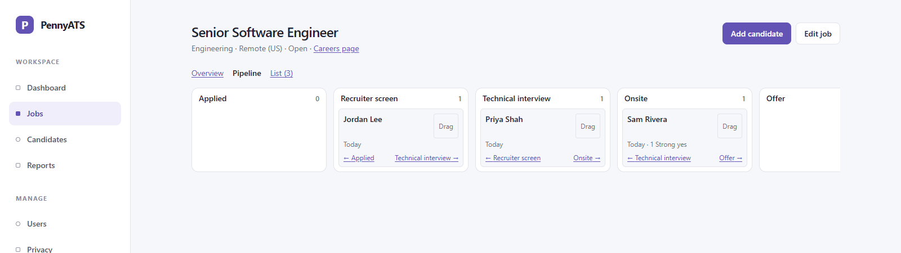
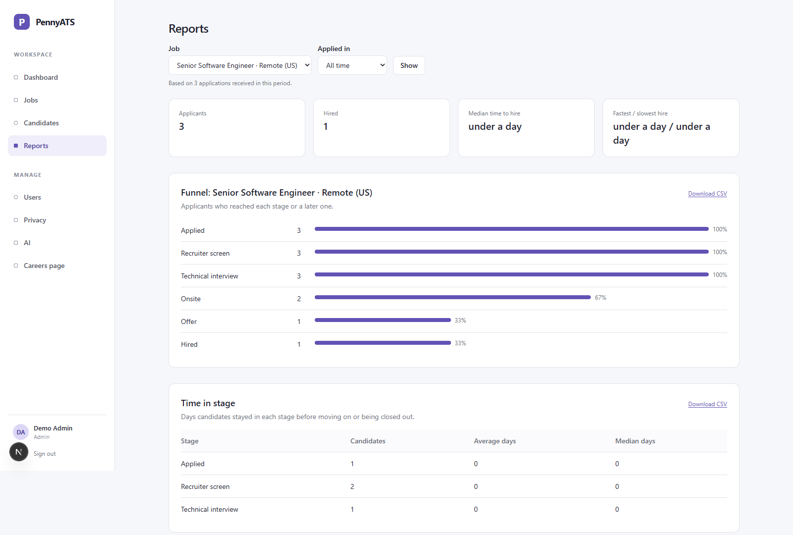

# PennyATS

[](https://github.com/PennyATS/PennyATS/actions/workflows/ci.yml)

**Run your hiring pipeline on your own infrastructure.**

Post jobs, review applicants, and collect interview feedback in one place.
Self-host PennyATS with your own Postgres database. AI features are optional
and off by default.

**Status: Early preview**

[Quick start](#quick-start) · [Roadmap](#roadmap) · [Contributing](CONTRIBUTING.md)

## Preview

These images use fictional candidates from the demo seed.


| Pipeline board | Candidate profile |
| --- | --- |
| [](docs/media/pipeline-board.png) | [](docs/media/candidate-profile.png) |
| **Scorecard** | **Reports** |
| [](docs/media/scorecard.png) | [](docs/media/reports.png) |

## What works today

- **Sign in and roles.** First-run setup creates the admin. Admins invite teammates, change roles, deactivate accounts, and issue one-time password reset links to copy and send. Interviewers only see jobs they're on the hiring team for.
- **Jobs.** Create and edit jobs as draft, open, or closed. Each job has its own pipeline stages (rename, reorder, add, remove) and hiring team.
- **Careers page.** Open jobs are listed at `/careers` with an apply form and resume upload. Includes basic spam protection.
- **Applications.** Candidates are matched by email, so someone applying to a second role keeps one profile. Recruiters can add candidates by hand, move them between stages, reject with a reason, or mark them withdrawn.
- **Pipeline board.** A kanban view per job. Drag candidates between stages, or use the arrow buttons from the keyboard. Cards show days in stage and scorecard results.
- **Interview loop.** Plan the interviews for each stage of a job (who runs them, what they cover, and instructions). Candidates get those interviews automatically when they enter the stage, with a status from "to schedule" to "complete", and the job overview flags interviewers whose feedback is overdue.
- **Scorecards.** Each job has its own list of attributes, rated 1 to 4, plus an overall recommendation from Strong no to Strong yes. Interviewers can't see anyone else's scorecard until they've submitted their own, so earlier feedback doesn't sway them.
- **Candidate profiles.** Contact details, resume download, every application, scorecards, notes, and an activity timeline. Mark candidates hired, rejected, or withdrawn.
- **Reports.** Filter by job and period to see the hiring funnel, time in each stage, time to hire, which sources produce hires, rejection reasons, and how many scorecards each interviewer has submitted.
- **Optional AI.** Bring your own Anthropic or OpenAI key (or a local model through an OpenAI-compatible server like Ollama) to draft job descriptions and summarize interview feedback. Off unless you add a key, and each feature can be switched off.
- **REST API and webhooks.** A documented [public API](docs/api.md) for jobs, stages, candidates, applications, scorecards, notes, tags, interviews, reports, and email, with an [OpenAPI document](docs/api/openapi.json) generated from the code. Admins create scoped keys that act as one teammate and can never do more than that person, so interviewer keys only see their jobs and scorecards stay blind. Every API write is in the audit log. Signed webhooks for new applications, stage changes, and scorecards, with retries and a delivery log. No per-seat limits.
- **MCP server for AI assistants.** Connect Claude, ChatGPT, or Cursor with a scoped key to search candidates, read scorecards, run reports, draft emails, and (if you allow it) move candidates and add notes. Read-only by default, with confirmation required before rejecting, emailing, or deleting.
- **Open data format.** Export everything (jobs, candidates, applications with stage history, interviews, scorecards, notes) as [documented, versioned JSON](docs/schema/README.md) with published JSON Schema, and import it into another instance. Your data is never locked in.
- **Privacy tools.** A privacy notice and optional consent checkbox on the apply form, one-click export of everything stored about a candidate, permanent deletion, automatic deletion of rejected candidates after a retention period you choose, and an audit log that records each of these without keeping the deleted person's details.

## Quick start

### Docker Compose

Docker Compose runs Postgres, applies migrations, and starts the production app:

```bash
cp .env.example .env
docker compose -f docker/docker-compose.yml up --build -d
```

Open http://localhost:3000 to create the first admin account. The database and uploaded resumes use persistent Docker volumes. See the [deployment guide](docs/deploy.md) before exposing the app to the internet.

### Local development

Requires Node 22+ and pnpm (`corepack enable` gives you the right version).

```bash
pnpm install
cp .env.example .env
```

Point `DATABASE_URL` in `.env` at any Postgres: a free [Neon](https://neon.tech) or Supabase database, RDS, or local Docker. PennyATS is developed and tested on Postgres 18; versions 14 and newer should work but aren't tested.

If you use the local Docker database, start only that service. Then create the tables and start the app:

```bash
docker compose -f docker/docker-compose.yml up -d db
pnpm db:migrate
pnpm dev
```

Open http://localhost:3000 and you'll be asked to create the first admin account.

### Demo data

To try it with sample data instead, run `pnpm db:seed` after migrating. It creates a small starter job (three made-up candidates) plus a larger reproducible software-engineering funnel from [`synthetic-recruiting`](https://github.com/Allen55/synthetic-recruiting): about nine jobs, ~1,400 synthetic candidates (`@example.com`, 555 numbers), stage history, interviews, and scorecards so the pipeline board, reports, and health checks have something to show. Demo login: `admin@example.com` / `pennyats-demo`. The same password works for `recruiter@example.com` and `dana.interviewer@example.com`. Only use the seed on a throwaway database.

## Privacy

Admins set this up under **Admin → Privacy** in the top navigation:

- **Notice and consent.** Text and a policy link shown on every apply form, with an optional required checkbox. The time of consent is saved on the candidate.
- **Access and deletion requests.** Each candidate profile has *Export all their data* (JSON) and *Delete permanently*, which removes them from every job along with their resume, scorecards, notes, and history.
- **Retention.** Pick a number of months, and rejected or withdrawn candidates with no activity for that long can be deleted from the Privacy page or on a schedule with `pnpm privacy:purge` (for example a daily cron job). Candidates with an active or hired application are never deleted.
- **AI.** When AI is turned on, emails, phone numbers, and links are swapped for placeholders before text leaves your server (an admin can turn this off under **AI**). Names are not detected, so this reduces exposure rather than eliminating it. Feedback summaries don't send the candidate's or interviewers' names at all. For no third-party sharing, point `AI_BASE_URL` at a model you host yourself.

Deleted data still exists in any database or file backups you keep, so expire those on a schedule too. These tools help with GDPR, CCPA, and similar laws, but they aren't legal advice.

## Configuration

| Variable | Purpose |
| --- | --- |
| `DATABASE_URL` | Any Postgres connection string. Required. |
| `APP_URL` | Public URL of the app, used in invite links. Use `https://` in production so the login cookie is marked Secure. |
| `STORAGE_DIR` | Where uploaded resumes are saved. Defaults to `apps/web/.data/uploads`. Back it up along with your database. |
| `AI_PROVIDER`, `AI_API_KEY`, `AI_MODEL` | Optional. `anthropic` or `openai`. Leave blank to keep every AI feature hidden. |
| `AI_BASE_URL` | Optional. Use an OpenAI-compatible server instead of the public API, for example a local model through Ollama (`http://localhost:11434/v1`). |
| `AI_REDACT_PII` | Defaults to `true`. Strips emails, phone numbers, and links before text is sent to a model. It's pattern-based and doesn't catch names. |
| `GOOGLE_CLIENT_ID`, `GOOGLE_CLIENT_SECRET` | Optional Google OAuth web client for interviewer free/busy and calendar invites. Add `${APP_URL}/api/google-calendar/callback` as an authorized redirect URI. |
| `SMTP_HOST`, `SMTP_PORT`, `SMTP_USER`, `SMTP_PASSWORD`, `SMTP_FROM` | Optional SMTP delivery for scheduling links and reminders. Port 465 uses TLS; other ports must support STARTTLS. |
| `API_RATE_LIMIT_PER_MINUTE` | Optional. Requests a minute allowed per API key. Defaults to 300. |

## Scheduling

Recruiters can schedule an interview manually from the candidate profile without Google Calendar. The interview keeps its scorecard and history when rescheduled or canceled. A connected interviewer can expose free/busy and enable a candidate-specific direct booking link; candidates can submit multiple availability windows without an account.

Stage scheduling settings live under each job. Automatic link delivery and reminders use SMTP and are opt-in. Run `pnpm scheduling:mail` regularly (for example every minute with cron) to dispatch due messages. The candidate profile shows queued, sent, failed, and suppressed messages. A failed SMTP attempt requires an explicit recruiter retry after checking the mail server; an uncertain sending claim is not replayed automatically.

With SMTP configured, admins can email team invites and password reset links. They can manage candidate email templates under **Admin → Email delivery**; recruiters can send a template from a candidate profile. Sent messages appear in the candidate timeline. If SMTP is unavailable, admins still receive a copyable invite or reset link.

Run `pnpm calendar:sync` regularly to pull Google Calendar edits, cancellations, and RSVP changes into PennyATS. Google API credentials and each interviewer's calendar connection are required for live calendar features. Recruiters can also refresh a linked interview from its candidate profile.

## API and webhooks

Admins create API keys and webhooks under **Admin > API and webhooks**. See [docs/api.md](docs/api.md) for authentication, scopes, errors, pagination, the audit log, and verifying webhook signatures. The full reference is [docs/api/openapi.json](docs/api/openapi.json), also served by your instance at `/api/v1/openapi.json`.

To connect a sourcing tool, a scheduler, or an AI assistant, start with [docs/integrations.md](docs/integrations.md); working reference integrations are in [`examples/`](examples).

To let Claude, ChatGPT, or Cursor work in PennyATS, run the [MCP server](docs/mcp.md) in `packages/mcp`. It is read-only by default, asks for confirmation before rejecting, emailing, or deleting, redacts contact details, and shows up in the audit log as agent activity.

Webhooks are sent right away and retried by the running server. Also schedule `pnpm webhooks:deliver` (for example every 5 minutes with cron) so retries survive a restart.

## Development

```bash
pnpm typecheck     # all packages
pnpm test          # unit tests (no database needed)
pnpm build         # production build
pnpm db:generate   # after changing packages/db/src/schema.ts; commit the migration
pnpm api:spec      # after changing the API; regenerates docs/api/openapi.json
pnpm schema:generate  # after changing the open data format; regenerates docs/schema/v1
pnpm data:export --out pennyats-export.json   # whole workspace in the open format
pnpm data:import pennyats-export.json         # import a file in the open format
```

```
apps/web         Next.js app (UI, server actions, API routes)
packages/db      Drizzle schema, migrations, seed, password hashing
packages/ai      Provider interface (Anthropic, OpenAI), off unless configured
packages/redact  PII redaction before AI calls
packages/mcp     MCP server for AI assistants, using the public API
packages/schema  Open data format: JSON Schema, workspace export and import
examples         Reference integrations: sourcing tool, scheduler, AI assistant
docker           Production Dockerfile and Docker Compose
```

## Contributing and security

See [CONTRIBUTING.md](CONTRIBUTING.md) for setup and conventions. To report a security problem privately, see [SECURITY.md](SECURITY.md).

## Roadmap

PennyATS is an early preview. The core applicant-tracking flow is built: accounts and roles, jobs, a careers page, applications, candidate review, pipeline stages, interview loops, scorecards, scheduling, email templates, privacy tools, reports and dashboards, and opt-in AI. The [GitHub project board](https://github.com/orgs/PennyATS/projects/1) is the source of truth for live status; the groups below explain the direction without promising a release date.

For the longer-term direction (agent-ready API and MCP server, security, compliance, and careers-page parity) see [ROADMAP.md](ROADMAP.md).

### Recently shipped

- **Agent-ready platform:** [public REST API with scoped keys, an OpenAPI document, and signed webhooks](https://github.com/PennyATS/PennyATS/issues/115), an [MCP server for Claude, ChatGPT, and Cursor](https://github.com/PennyATS/PennyATS/issues/116), an [open, versioned data format with export and import](https://github.com/PennyATS/PennyATS/issues/114), and [integration points with reference integrations for sourcing, scheduling, and AI assistants](https://github.com/PennyATS/PennyATS/issues/117).
- **Candidate review:** [column filters](https://github.com/PennyATS/PennyATS/issues/67), [boolean search across resumes, notes, and phone screens](https://github.com/PennyATS/PennyATS/issues/70), [next / previous review arrows](https://github.com/PennyATS/PennyATS/issues/72), [tags](https://github.com/PennyATS/PennyATS/issues/69), [resume on the profile](https://github.com/PennyATS/PennyATS/issues/68), [standard rejection reasons](https://github.com/PennyATS/PennyATS/issues/71), and [phone screen notes with an Archived view](https://github.com/PennyATS/PennyATS/issues/73).
- **Jobs:** [compensation, hiring manager, and planning fields](https://github.com/PennyATS/PennyATS/issues/75), [job sub-navigation, stage tabs, and a details drawer](https://github.com/PennyATS/PennyATS/issues/79), [job overview and pipeline health](https://github.com/PennyATS/PennyATS/issues/33), [interview plans per job](https://github.com/PennyATS/PennyATS/issues/32), and [tidier job settings pages](https://github.com/PennyATS/PennyATS/issues/91).
- **Dashboards and reports:** [Home, Executive, and Jobs dashboards](https://github.com/PennyATS/PennyATS/issues/78), [report charts with a graph / table toggle](https://github.com/PennyATS/PennyATS/issues/74), and [a fixed-order pipeline snapshot](https://github.com/PennyATS/PennyATS/issues/76).
- **Navigation and design:** [Ashby-style navigation folders, search, and Add menu](https://github.com/PennyATS/PennyATS/issues/77) [in a brand-left layout](https://github.com/PennyATS/PennyATS/issues/89), [notifications](https://github.com/PennyATS/PennyATS/issues/80), and [consistent surfaces for tables, cards, and buttons](https://github.com/PennyATS/PennyATS/issues/35).
- **Scheduling and email:** [manual interview scheduling from the candidate profile](https://github.com/PennyATS/PennyATS/issues/50) and [email templates with folders and stage-triggered sending](https://github.com/PennyATS/PennyATS/issues/64).
- **Foundation:** [role changes and deactivation](https://github.com/PennyATS/PennyATS/issues/1), [password resets](https://github.com/PennyATS/PennyATS/issues/2), [Docker deployment](https://github.com/PennyATS/PennyATS/issues/3), [CI](https://github.com/PennyATS/PennyATS/issues/4) with [browser and database integration tests](https://github.com/PennyATS/PennyATS/issues/18), [MIT license](https://github.com/PennyATS/PennyATS/issues/7), and [deployment, security, and contributor docs](https://github.com/PennyATS/PennyATS/issues/11).

### Next: access and administration

[Access management](https://github.com/PennyATS/PennyATS/issues/93) moves from three fixed roles to named permissions and role presets for **Executives, Head of Talent, Talent Acquisition Managers, Recruiters, Recruiting Coordinators, Hiring Managers, and Interviewers**, with admins configuring the instance.

- [Permission model](https://github.com/PennyATS/PennyATS/issues/94) and [default role presets](https://github.com/PennyATS/PennyATS/issues/95).
- [Job-level access through hiring team roles, and confidential jobs](https://github.com/PennyATS/PennyATS/issues/96).
- [Sensitive data rules for compensation, scorecards, phone screen notes, and privacy actions](https://github.com/PennyATS/PennyATS/issues/97).
- Admin tools: [users and invites](https://github.com/PennyATS/PennyATS/issues/98), [custom roles](https://github.com/PennyATS/PennyATS/issues/99), and an [organization settings hub](https://github.com/PennyATS/PennyATS/issues/100) (company details, departments, default stages, editable rejection reasons).
- [Personal settings and notification preferences](https://github.com/PennyATS/PennyATS/issues/101), an [audit log for access and configuration changes](https://github.com/PennyATS/PennyATS/issues/102), [sessions, password policy, and two-factor sign-in](https://github.com/PennyATS/PennyATS/issues/103), and [single sign-on](https://github.com/PennyATS/PennyATS/issues/104).
- [A permission-aware interface with role-tailored home pages](https://github.com/PennyATS/PennyATS/issues/105).

### Before launch and public demo

- [Finish the visual design](https://github.com/PennyATS/PennyATS/issues/8), including dark mode and restyling the candidate profile and settings pages.
- [Verify AI features with real Anthropic and OpenAI keys and a local compatible server](https://github.com/PennyATS/PennyATS/issues/6).
- [Host a public demo with fictional data that resets automatically](https://github.com/PennyATS/PennyATS/issues/10).

### Scheduling suite

- [Scheduling suite](https://github.com/PennyATS/PennyATS/issues/43) on top of the [Google integration](https://github.com/PennyATS/PennyATS/issues/40): [candidate self-booking](https://github.com/PennyATS/PennyATS/issues/51), [two-way Google Calendar sync and RSVPs](https://github.com/PennyATS/PennyATS/issues/52), [collecting availability for panels](https://github.com/PennyATS/PennyATS/issues/53), and [reminders and scheduling on stage entry](https://github.com/PennyATS/PennyATS/issues/54).

### Later on the roadmap

- [Candidate and team email, invitations, and password resets by email](https://github.com/PennyATS/PennyATS/issues/19).
- [CSV import from Greenhouse and other applicant tracking systems](https://github.com/PennyATS/PennyATS/issues/20).

### Proposals still to scope

- [Agency portal](https://github.com/PennyATS/PennyATS/issues/24), [custom branding](https://github.com/PennyATS/PennyATS/issues/25), [sourcing extension](https://github.com/PennyATS/PennyATS/issues/26), [expanded analytics](https://github.com/PennyATS/PennyATS/issues/28), and [a light/dark theme toggle](https://github.com/PennyATS/PennyATS/issues/30).
- [Deferred ideas](https://github.com/PennyATS/PennyATS/issues/21) include offers and e-signatures (which would fill in the offer acceptance rate on the executive dashboard), job-board posting, resume parsing for PDF and Word files, and multi-tenant hosting.

## License

PennyATS is available under the [MIT License](LICENSE).
